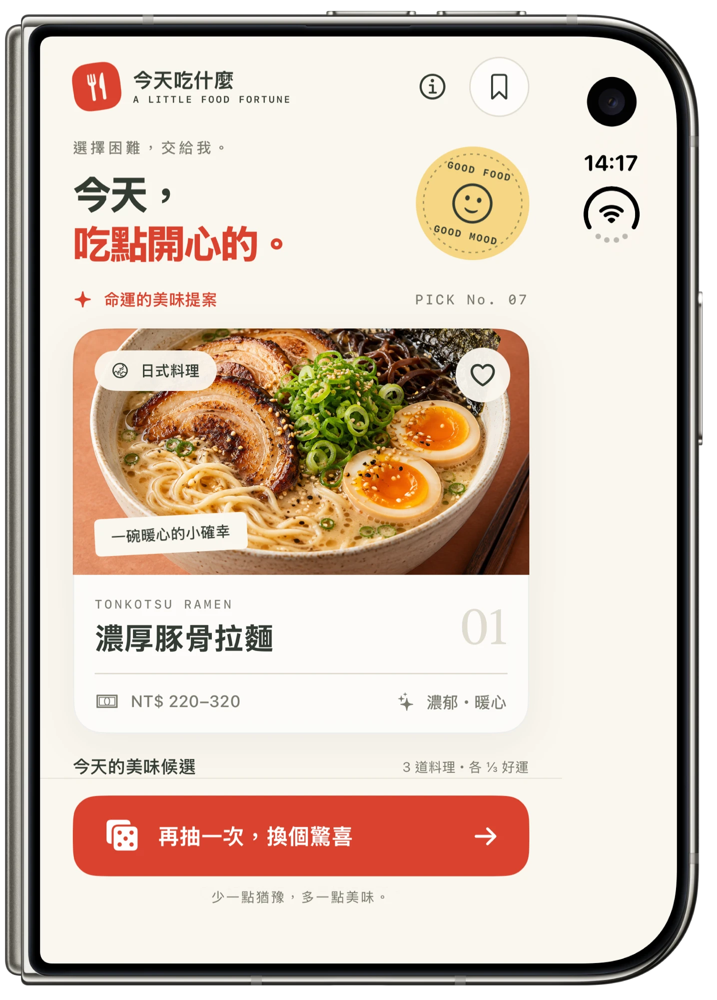

<div align="center">

# 🍜 TodayEat · 今天吃什麼

**A little food fortune — let fate decide your next meal.**
**選擇困難，交給我。**


[🇺🇸 English](#-english) · [🇹🇼 繁體中文](#-繁體中文)



</div>

---

## 🇺🇸 English

> Can't decide what to eat? Tap the button and let a little food fortune pick for you. 🎲

### ✨ Features

- 🎲 **Random draw** — Every draw gives each meal an equal ⅓ chance, with a playful shuffle animation and haptic feedback.
- 🍱 **Curated menu** — Tonkotsu Ramen 🍜, Classic Cheeseburger 🍔 and Colorful Bibimbap 🥗, each with cuisine, budget, flavor notes and a short story.
- ❤️ **Favorites** — Save the meals you love; your collection persists across launches.
- 👆 **Pick manually** — Tap any candidate in "Today's Picks" to view it directly.
- ♿️ **Accessible** — Respects *Reduce Motion* and adapts to short canvases (landscape, foldables).
- 🖥️ **Multiplatform** — One SwiftUI codebase for iPhone, iPad, Mac and Apple Vision Pro.
- 🖼️ **Offline assets** — AI-generated food photography bundled in the asset catalog ([prompts](Docs/AI-Assets.md)).

### 🧱 Tech Stack

| | |
|---|---|
| 🧑‍💻 Language | Swift |
| 🎨 UI | SwiftUI |
| 💾 Persistence | `@AppStorage` |
| 📳 Feedback | `sensoryFeedback` |
| 🌏 Localization | `LocalizedStringResource` |

### 📁 Project Structure

```
TodayEat/
├── MyApp.swift        # App entry point
├── ContentView.swift  # Main screen, meal card, draw bar, sheets
├── Meal.swift         # Meal model, catalog & random draw
└── Assets.xcassets    # Food photos & app icon
Docs/
├── AI-Assets.md       # Image generation prompts
└── screenshot.webp
```

### 🚀 Getting Started

1. Clone the repository
   ```bash
   git clone https://github.com/PeterPanSwift/TodayEat.git
   ```
2. Open `TodayEat.xcodeproj` in Xcode 27 or later.
3. Choose an iPhone simulator (or My Mac / Apple Vision Pro) and press **⌘R**. 🎉

> 💡 Prices are illustrative meal budgets, not live quotes.

<p align="right"><a href="#-todayeat--今天吃什麼">⬆️ Back to top</a></p>

---

## 🇹🇼 繁體中文

> 不知道今天要吃什麼？按下按鈕，讓命運替你決定這一餐。🎲

### ✨ 功能特色

- 🎲 **隨機抽選** — 每次抽選三道料理機率均等（各 ⅓），搭配洗牌動畫與觸覺回饋。
- 🍱 **精選菜單** — 濃厚豚骨拉麵 🍜、經典起司漢堡 🍔、韓式繽紛拌飯 🥗，附上料理類別、預算、風味與小故事。
- ❤️ **收藏功能** — 把喜歡的料理加入收藏，重新開啟 App 也不會消失。
- 👆 **手動挑選** — 點選「今天的美味候選」中的任一道料理即可直接查看。
- ♿️ **無障礙友善** — 支援「減少動態效果」，並針對矮版畫面（橫向、摺疊機）自動調整版面。
- 🖥️ **跨平台** — 同一份 SwiftUI 程式碼支援 iPhone、iPad、Mac 與 Apple Vision Pro。
- 🖼️ **離線圖片** — AI 生成的美食照片內建於 Asset Catalog（[提示詞](Docs/AI-Assets.md)）。

### 🧱 技術棧

| | |
|---|---|
| 🧑‍💻 語言 | Swift |
| 🎨 介面 | SwiftUI |
| 💾 資料保存 | `@AppStorage` |
| 📳 回饋 | `sensoryFeedback` |
| 🌏 在地化 | `LocalizedStringResource` |

### 📁 專案結構

```
TodayEat/
├── MyApp.swift        # App 進入點
├── ContentView.swift  # 主畫面、料理卡片、抽選列、Sheet
├── Meal.swift         # 料理模型、菜單與隨機抽選
└── Assets.xcassets    # 美食照片與 App 圖示
Docs/
├── AI-Assets.md       # 圖片生成提示詞
└── screenshot.webp
```

### 🚀 開始使用

1. 複製專案
   ```bash
   git clone https://github.com/PeterPanSwift/TodayEat.git
   ```
2. 使用 Xcode 27 以上版本開啟 `TodayEat.xcodeproj`。
3. 選擇 iPhone 模擬器（或 My Mac / Apple Vision Pro），按下 **⌘R**。🎉

> 💡 價格為參考用的餐點預算，並非即時報價。

<p align="right"><a href="#-todayeat--今天吃什麼">⬆️ 回到頂端</a></p>

---

<div align="center">

少一點猶豫，多一點美味。🍽️

</div>
